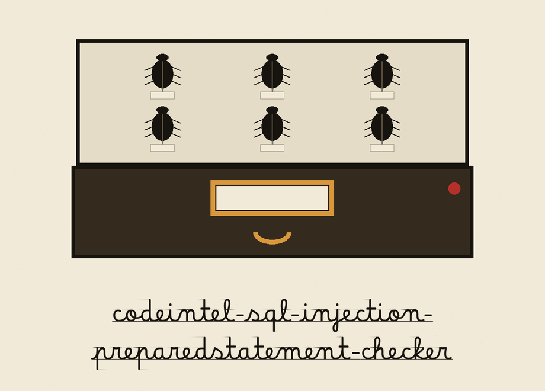
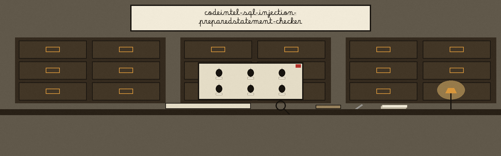

Specimen label plate: the title below is set in Betania Patmos GDL in cabinet black on a bone white plate ruled as a specimen label. A small beetle drawer thumbnail sits beside the major headings, at punctuation size; plain ruled headings serve at minor sections.

# codeintel-SQL-Injection-PreparedStatement-Checker

Identifies locations where string concatenation is used to build SQL queries instead of using prepared statements, highlighting potential SQL injection vulnerabilities. Employs AST parsing to analyze SQL query construction. - Focused on Tools for static code analysis, vulnerability scanning, and code quality assurance

## Install
`git clone https://github.com/ShadowStrikeHQ/codeintel-sql-injection-preparedstatement-checker`

> **Label inset: Clone Line Names the Wrong House.** The install line above names ShadowStrikeHQ in place of ShadowGuard-AI. It is preserved exactly as printed and flagged here, never silently fixed.

## Usage
`./codeintel-sql-injection-preparedstatement-checker [params]`

> **Label inset, flagged in place.** The usage line above is a placeholder. It names no file path, although the parser requires one Python file path as a positional argument, and the parameter list below does not name that path.

## Parameters
- `-h`: Show help message and exit
- `--ignore`: List of functions/methods to ignore during analysis (e.g., 

> **Label inset, recorded as printed.** The ignore entry above ends in mid example, exactly as printed, with no example or closing mark following it in the README. The narrower code accounts of the ignore test sit on the website; the README scene keeps the README text and the code correction apart.
- `--log-level`: No description provided

## What is checked and what a clean result means
> **Label inset: Assignment Lines Miss Two Forms.** The section below states that all four construction forms are checked in both places. The code checks assignment lines for the plus build and the f-string build only; percent formatting and the format call are checked in call arguments only. The wider sentence stands as printed and is recorded here as an overstatement.

SQL built with `+`, an f-string with formatted values, `%` formatting, or a `.format` call is checked both on assignment lines and in arguments passed straight to a call such as `execute(...)`. The line "No potential SQL injection vulnerabilities found." is printed only for a file that was read and parsed. A file that cannot be read or parsed exits 1 and never prints that line.

## License
Copyright (c) ShadowStrikeHQ

> **Label inset, flagged in place.** The closing line above reads Copyright (c) ShadowStrikeHQ, the same wrong house name as the clone line. It is preserved exactly as printed, and no licence name is added, because the README gives none.
